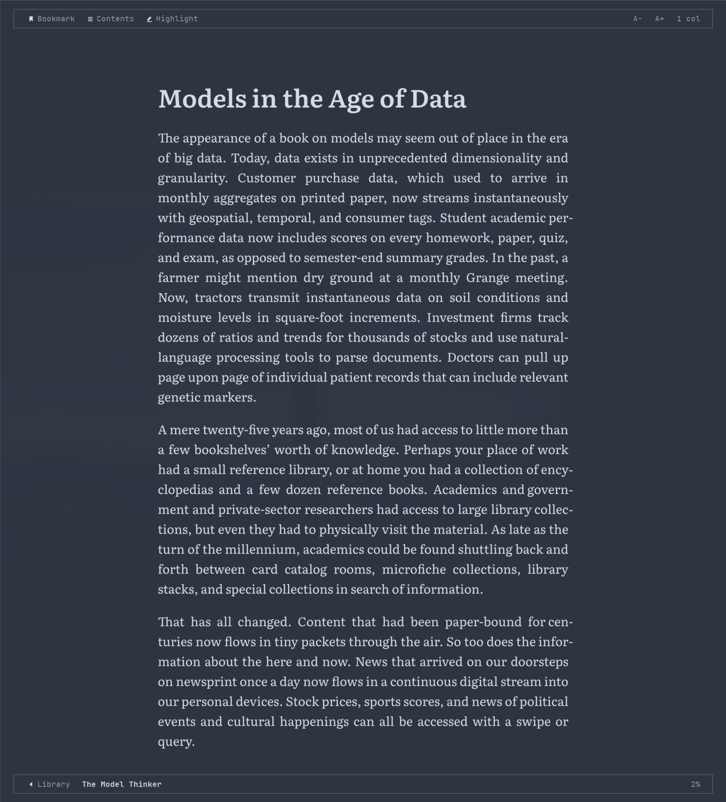

# Omaread

An e-book reader for [Omarchy](https://omarchy.org), and for any Wayland desktop.
EPUB, AZW3 and MOBI, set like a printed page: justified, hyphenated, paginated,
in a typeface made for reading.



- **Pure Rust, no web view.** The book is laid out by [Blitz](https://github.com/DioxusLabs/blitz)
  (Stylo, Taffy, Parley) and drawn on the CPU. No WebKit, no Electron, no GPU stack.
- **Private by construction.** Omaread never makes a network request: no HTTP
  client is linked at all. Remote images and stylesheets in a book are not fetched,
  and an external link asks before it opens your browser.
- **Follows your desktop.** On Omarchy the library, menus and page take the
  current theme's colours and fonts, and change with it.

## Features

- **A real page.** Books are paginated line by line, never cut through a line,
  table row or code line, with widow and orphan control and table headers repeated
  across pages. One or two columns.
- **The publisher's CSS is set aside.** Omaread uses its own stylesheet,
  keeping only what carries meaning: italics, bold, alignment, image sizes.
  Text is set in bundled Literata, with Charis SIL for rarer scripts.
- **Hyphenation** for English, Spanish and Catalan, chosen by the book's language.
- **Five themes:** Omarchy (your desktop's palette), White, Sepia, Grey and Night.
- **Library:** a grid of covers, sorted by recent, title or author, with tags
  and collections. Search matches titles, authors *and the full text of every
  book*.
- **Search inside a book**, accent-insensitive: "cancion" finds "canción".
- **Bookmarks, highlights and notes**, exported to Markdown on request.
- **Your place is kept** as an EPUB CFI, so it survives a font size change.
- **Kindle formats** (AZW3, MOBI) are read in place, not converted. DRM-protected
  files are not supported.
- **Screen readers** through AT-SPI.
- **English and Spanish** interface.

PDF is out of scope: [zathura](https://pwmt.org/projects/zathura/) does it well.

## Install

### Arch Linux and Omarchy

The AUR package, `omaread-git`, is on its way. Until then, build the same
package from this repository:

```sh
git clone https://github.com/danielgccr/omaread.git
cd omaread/packaging/aur
makepkg -si
```

The package builds from the latest commit, and installs the launcher entry
and the Omarchy files described below. For the file pickers, "Show in
folder" and moving removed books to the trash, you need `xdg-desktop-portal`,
which Omarchy already has.

### From source

You need a recent stable Rust (the crate is edition 2024), and fontconfig,
Wayland and libxkbcommon at run time.

```sh
git clone https://github.com/danielgccr/omaread.git
cd omaread
cargo build --release
install -Dm755 target/release/omaread ~/.local/bin/omaread
install -Dm644 assets/omaread.desktop ~/.local/share/applications/omaread.desktop
```

Always build with `--release`. A debug build works, but it is too slow to read in.

## Omarchy setup

Both steps are optional. Omaread runs without them, with the Sepia theme and
in a tiled window.

**Follow the theme.** Copy the theme template to where Omarchy renders
templates:

```sh
cp /usr/share/omaread/omarchy/omaread.css.tpl ~/.config/omarchy/themed/
```

then pick a theme once from Omarchy's theme menu, so it renders. From then on,
a theme change reaches an open Omaread window straight away.

**Float the window.** A book reads best as a centred page, not as a tiled
column. The suggested Hyprland rules also bind <kbd>Super</kbd> <kbd>Shift</kbd>
<kbd>L</kbd> to open the library:

```sh
cp /usr/share/omaread/omarchy/omaread.lua ~/.config/hypr/omaread.lua
```

then add `require("hypr.omaread")` to `~/.config/hypr/hyprland.lua`.

If you built from source, the two files are in `assets/omarchy/`.

## Using it

```sh
omaread               # the library
omaread book.epub     # straight into a book (also .azw3, .mobi)
```

On first run Omaread scans `~/Documents` and `~/Downloads` for books. Add or
remove folders from the settings panel (the cog, or <kbd>F10</kbd>). Opening a
book copies it into Omaread's own library. Your files in watched folders are
only ever read: never renamed, moved or deleted.

Press <kbd>?</kbd> (or <kbd>F1</kbd>) in any view to see its keys. The main ones:

| Library | |
|---|---|
| type | Search titles, authors and full text |
| `#tag` | Show a tag or collection |
| <kbd>Enter</kbd> | Open the book |
| <kbd>F2</kbd> | Tag the book |
| <kbd>F3</kbd> | Open a book from a file |
| <kbd>Del</kbd> | Remove from the library |
| <kbd>Tab</kbd> | Change the order |
| <kbd>F5</kbd> | Rescan the folders |
| right-click | Show in folder, remove |

| Reading | |
|---|---|
| <kbd>←</kbd> <kbd>→</kbd> <kbd>Space</kbd> | Turn the page |
| <kbd>↑</kbd> <kbd>↓</kbd> | Previous or next chapter |
| <kbd>g</kbd> | Go to a page or percentage |
| <kbd>Tab</kbd> | Contents |
| <kbd>/</kbd> | Search the book |
| <kbd>m</kbd> | Bookmarks and highlights |
| <kbd>b</kbd> | Bookmark the page |
| drag, then <kbd>h</kbd> / <kbd>y</kbd> | Highlight or copy the selection |
| <kbd>t</kbd> | Next theme |
| <kbd>+</kbd> <kbd>-</kbd> | Text size |
| <kbd>c</kbd> | One or two columns |
| <kbd>l</kbd> <kbd>Esc</kbd> | Back to the library |
| <kbd>q</kbd> | Quit |

Moving the mouse shows bars with the same controls at the top and bottom of
the page. Right-click the page for copy, highlight, note and bookmark.

"Remove from the library" moves Omaread's own copy to the trash and hides the
book. Its progress and highlights are kept, and opening it again brings it back.

### Where things are kept

| | |
|---|---|
| `~/.local/share/omaread/` | The library copies, the database (positions, marks, tags, search index) and exported highlights |
| `~/.config/omaread/` | Settings and the list of watched folders |

Both follow `XDG_DATA_HOME` and `XDG_CONFIG_HOME`. To try Omaread without
touching your real library:

```sh
XDG_DATA_HOME=/tmp/omaread-try XDG_CONFIG_HOME=/tmp/omaread-try omaread
```

## Known limitations

- Wayland first. Dropping a file on the window only works under X11 or XWayland,
  because winit has no drag and drop on Wayland yet.
- Right-to-left and vertical writing are planned, not built.
- Full-text search covers a book once it has been opened. `omaread --index`
  indexes the whole library at once.

## Development

```sh
cargo test --release
omaread --check book.epub ...   # headless conformance run: panics, cut lines, stalls
```

CI runs the test suite and `--check` over the W3C EPUB test suite and the
epubtest.org books.

## License

GPL-3.0-or-later. See [`LICENSE`](LICENSE).

The bundled fonts, Literata, Charis SIL and IBM Plex Mono, are under the SIL
Open Font License. Their licenses are in [`assets/fonts/`](assets/fonts/).
